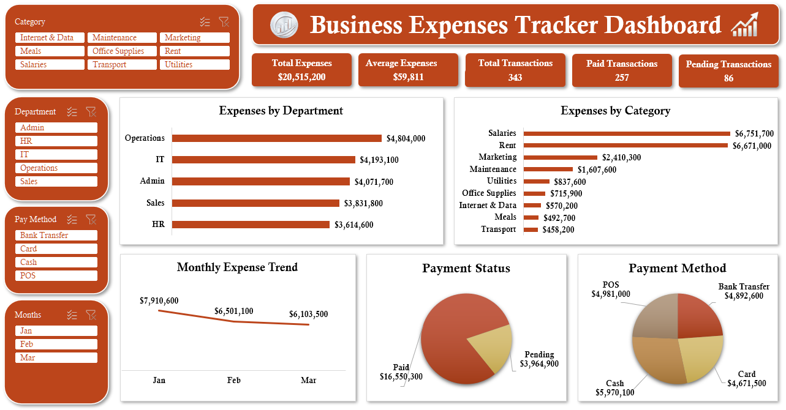
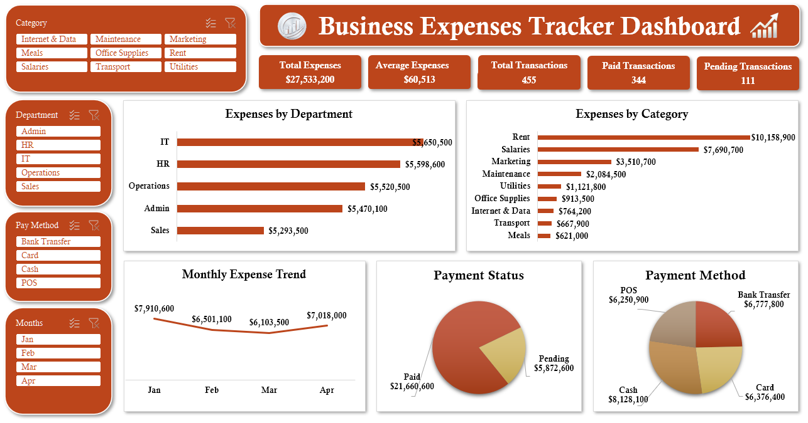

# Business Expenses Tracker Dashboard

An interactive Excel dashboard that tracks business spending by department, category, payment method and month. It updates automatically when new monthly data is added.

## Preview

### Version 1: January to March
- Total Expenses: $20,515,200
- Total Transactions: 343 (257 paid, 86 pending)

### Version 2: April data added
- Total Expenses: $27,533,200
- Total Transactions: 455 (344 paid, 111 pending)
- The Monthly Trend chart and the Months slicer now include April

After I added April's CSV to the source folder and clicked Refresh All, every KPI, chart and slicer updated without rebuilding anything.

## Features
- Slicers for Category, Department, Pay Method and Months
- KPI cards: Total Expenses, Average Expense, Total, Paid and Pending Transactions
- Bar charts for Expenses by Department and by Category
- Line chart for Monthly Expense Trend
- Pie charts for Payment Status and Payment Method

## Key Insights (Version 2)
- Rent ($10.2M) and Salaries ($7.7M) are the biggest cost categories.
- IT is the highest-spending department, followed closely by HR.
- Monthly spending fell from January to March, then rose in April.
- About 21% of total expenses are still pending payment.

## Source Data
Monthly source files (CSV) are in the `source-data` folder, January to April. They are combined with Power Query, so adding a new month's file and clicking Refresh All updates the whole dashboard.

Data is simulated for practice.

## Project Structure
- `dashboard/` : Excel dashboard file
- `images/` : dashboard screenshots
- `source-data/` : monthly CSV files

## Download
[Business-Expenses-Tracker.xlsx](dashboard/Business-Expenses-Tracker.xlsx)

Note: The Power Query connection points to a folder on my computer. To refresh with your own data, change the folder path in Data > Get Data > Data Source Settings.

## Tools Used
Excel, Power Query, Pivot Tables, Slicers, Formulas

## Author
Adeleye Babatunde John
GitHub: [abjunited](https://github.com/abjunited)
